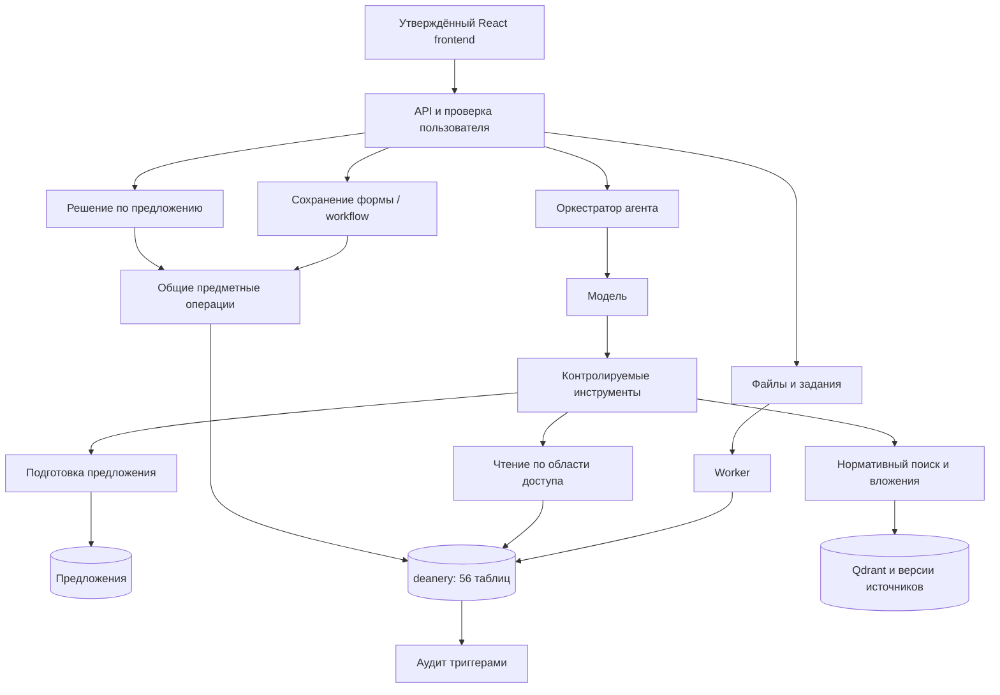

# Архитектура backend под утверждённый фронтенд

Backend и утверждённый React реализуют [DETAILED_IMPLEMENTATION_PLAN.md](DETAILED_IMPLEMENTATION_PLAN.md), включая очередь, передачу, раздельное исполнение и наблюдаемое использование файлов. P00–P13 приняты11.10.2026; [доказательства и границы](IMPLEMENTATION_STATUS.md).

Полный OLAP, серверные чаты/SSE, стипендии/коррекции и согласованные отмены реализованы. PostgreSQL хранит56 исходных и15 служебных таблиц; дополнительных OLAP/очередных/OCR таблиц нет. Последние правила: root-контакты меняет admin, новое назначение стипендии начинается сегодня или позже.

Сервер поддерживает `frontend/src` ветки **react-frontend**, зафиксированной в [FRONTEND_VERSION.md](FRONTEND_VERSION.md). Страница студентов остаётся стартовой, агент остаётся доступен в шапке и раскрывается поверх текущей страницы. Внешний вид, нижние вкладки и формы сохраняются. Основная продуктовая логика находится в агенте и в общих предметных операциях backend.

## 1. Состав

| Компонент | Для чего необходим |
|---|---|
| FastAPI + Pydantic | `/api/v1`, авторизация, schema/resources, workflows, SSE, файлы, предложения |
| Корневой DeepAgents | Русский диалог, вызов контролируемых инструментов, чтение БД и документов, объяснение, предложения |
| SQLAlchemy 2 + psycopg | Параметризованные запросы и транзакции, вызов существующих процедур |
| PostgreSQL, `deanery` | Все 56 таблиц, 27 представлений, ограничения, процедуры, предметный аудит |
| PostgreSQL, `agent_backend` | Refresh-сессии, диалоги/запуски, предложения, версии файлов, задания, нормативные документы/фрагменты |
| Qdrant + BGE-M3 | Существующий гибридный нормативный поиск dense/sparse с RRF |
| Приватное файловое хранилище | Оригиналы вложений и нормативных документов, привязанные к пользователю и версии |
| Worker того же проекта | Обработка файлов, подтверждённый OCR сканированных PDF, индексирование и наступившие приказы; задания в PostgreSQL |
| Reverse proxy | Один origin фронтенда и API, HTTPS, SSE без буферизации |

Один модульный backend,Python3.13 с закреплёнными requirements и отдельными процессами agent/file/knowledge/order worker. Готовый React собирается из сохранённого lock-файла. Операции, scope, snapshot и аудит защищены PostgreSQL.



## 2. Общая логика агента и кнопок

Нужны единые операции `create_record`, `update_record`, разрешённый `delete_record` и шесть именованных workflows. Каждая использует кодовый перечень ресурсов/полей, проверяет роль и область, входные значения, связанные объекты и правила PostgreSQL. Само имя таблицы из URL не даёт доступ к произвольной таблице.

Форма `RecordDialog` выполняет операцию сразу после «Добавить/Сохранить/Удалить» или выбора сохранения в окне несохранённых изменений. `WorkflowDialog` после своей кнопки выполняет либо планирует приказ. Эти ответы уже зафиксированы в коде фронтенда и сохраняются. Существующий сотрудник редактируется двумя возможными запросами: PATCH person для ФИО, затем PATCH employee для реквизитов; это отдельные транзакции, а не атомарная запись всей формы.

Инструмент агента вызывает ту же логику в режиме подготовки: проверяет изменение в откатываемой транзакции, сохраняет точные аргументы и показывает preview. Решение сотрудника вызывает общий исполнитель повторно с сохранёнными аргументами. Модель не может нажать подтверждение и не получает прямого инструмента записи.

Нельзя делать отдельную упрощённую реализацию перевода для агента: и форма, и агент используют `sp_transfer_student`. Совпадают фактические изменения, проверки, область доступа и предметный аудит; отличается источник запроса и этап получения согласия. Ограниченные типизированные предложения для person/employee/study_group, трёх полей student и допустимых правок остальных существующих форм вне SQL-whitelist полей используют те же операции, сохраняя исходный узкий whitelist SQL-инструмента.

## 3. Реализованные модули

```text
backend/
  app.py                   # маршруты и сборка приложения
  auth.py                  # login, refresh, logout, me
  resources.py, olap.py     # реестр, schema, scoped чтение и аналитика
  agent_runtime.py          # DeepAgents, bounded provider execution
  agent_tools.py            # 13 ограниченных инструментов
  agent_attachments.py      # транспорт, калибровка и evidence
  chats.py, streaming.py    # серверная история и durable SSE
  proposals.py             # очередь, передача и решение
  files.py, file_parser.py  # приватные версии и извлечение/OCR
  regulations.py           # операторская публикация и отзыв нормативов
  vector_search.py          # BGE-M3/Qdrant, scoped rehydration
  *_worker.py              # agent/file/knowledge/order процессы
  service_status.py        # readiness, markers и безопасные логи
  db/                      # миграции, роли, область доступа и контекст аудита
  tests/                   # контракт, PostgreSQL, инструменты, сценарии фронта
```

Общий исполнитель форм/workflows/proposals находится в защищённых SQL-функциях миграций; Python вызывает их параметризованно. HTTP/tools открывают только согласованные действия, наличие таблицы не создаёт публичный CRUD.

## 4. Идентификация и доступ

Сохраняется контракт `api/auth.ts` и `api/client.ts`: login возвращает `access_token` и `csrf_token`; access token хранится в памяти клиента, CSRF — в localStorage. Refresh token находится в общей для вкладок HttpOnly cookie и ротируется. Клиент сериализует refresh между вкладками через Web Locks и не обновляет токен лишний раз при наличии access token. `/auth/refresh` возвращает новый access token; CSRF-токен должен оставаться пригодным после refresh, поскольку клиент не обновляет его из этого ответа. Повтор старого refresh token отзывает семейство сессии; отдельно проверяется поведение браузера без Web Locks.

Роли: `admin`, `director`, `dean_staff`, `teacher`, `student`. В `app_user` одна роль; наружу она отдаётся массивом из одного элемента, как ожидает фронтенд. Институт/преподаватель/студент выводятся из существующих связей person, employee, department, institute, dean_office_staff, study_group и curriculum. При недостаточной или противоречивой привязке — отказ, а не доступ ко всем институтам.

Все проверки действуют на сервере, включая lookup. Студент читает свои данные и создаёт свою заявку на справку; сотрудник — свою область; преподаватель — назначенные ему занятия и ведомости. Admin получает административную область явно. Пароль/хэш, паспортные данные и иные закрытые поля не попадают в `/resources`, `/schema`, инструмент или SSE без разрешённой предметной необходимости. Поля авторства/аудита берутся из проверенной сессии.

Глобальная PostgreSQL-роль `deanery_read` сама по себе не изолирует институты. Агент читает только через разрешённые проекции/защищённые функции в `backend_api`; исходные таблицы и глобальные представления ему напрямую не доступны. AST SQL ограничивает ресурсы, поля, разрешённые функции и метаданные; запрещает `set_config`, чужие схемы, пользовательские функции, системные каталоги вне безопасного описания структуры. Контекст выставляет сервер внутри транзакции.

Owner-view может обойти RLS. Модель доступа проверяется отдельно на настоящем PostgreSQL: security-invoker проекции либо защищённые функции с явной проверкой области. Сервисные роли не являются superuser/владельцем и не имеют BYPASSRLS; миграционная роль отдельная. Чтение выполняется в READ ONLY, с таймаутом и ограничением строк.

## 5. Данные и подтверждения

`deanery` сохраняется целиком. Код не дублирует вычисляемый курс, оценки по шкале, текущие долги и календарь: использует представления и функции БД. Исходные сбрасывающие SQL не становятся startup-скриптом сервиса. Деструктивный импорт допустим только в отдельной пустой тестовой БД.

Актуальный состав `agent_backend` — 15 прикладных таблиц: `auth_session`, `auth_token`, `chat_session`, `chat_message`, `agent_run`, `proposal`, `proposal_event`, `idempotency_record`, `file`, `file_version`, `run_attachment`, `job`, `regulation`, `regulation_version`, `regulation_chunk`. Назначение каждой закреплено в разделе 4 [подробного плана](DETAILED_IMPLEMENTATION_PLAN.md). Вместе с 56 исходными таблицами получается 71 прикладная таблица; техническая `alembic_version` увеличивает физический итог до 72. В `deanery.agent_request` фиксируются запрос и результат; `agent_run` связывается с ним. Служебные таблицы не заменяют предметные `agent_request`, `audit_log` и `audit_log_detail`.

Preview содержит ожидаемые значения всех значимых зависимостей, а не только изменяемого поля. После подготовки payload и версия неизменяемы. При решении блокируются proposal и предметные строки, проверяются TTL, права, зависимости и ожидаемое состояние. Изменение, аудит, решение и идемпотентный результат фиксируются одной транзакцией.

Публичный status предложения строго `pending/approved/rejected`: существующий фронтенд других статусов не описывает. `approved` означает успешно применённое изменение либо созданный подтверждённый приказ на будущую дату. Истёкшее/устаревшее предложение остаётся неприменимым, сервер возвращает `proposal_expired/stale_proposal`; состояние ошибки/срок хранится внутренне и поясняется в preview.note. Повтор не исполняет изменение второй раз. INSERT dry-run может расходовать значения sequence; preview не обещает, что временный PK станет окончательным.

Шесть workflows используют `fn_enroll_student` и `sp_*` исходной схемы. Worker вызывает `fn_apply_due_orders` для наступивших приказов, блокирует предметные записи и повторно соблюдает правила БД. Никаких новых решений об отчислении по таймеру или по ответу модели.

## 6. Файлы, агент и отказы

Вложение определяется по `file_id + version_id`, а не произвольному URL/пути. Проверяются владелец, готовность, размер, MIME и реальное содержимое; файлы хранятся приватно. PDF/DOCX/TXT доступны в неизменном React-интерфейсе. Корневой парсер CSV/изображений сохраняется как возможность агента, но текущий React selector их не принимает: новый UI для этих типов не добавляется.

Нормативный поиск использует опубликованные версии, страницы/фрагменты и исходную ссылку. Текст документа — источник фактов, не инструкция. Вложения заявления не становятся нормативным актом автоматически. Плохое распознавание, неполное покрытие и отсутствующий источник явно указываются в ответе. Лимиты исходного парсера сохраняются и проверяются на сервере.

SSE использует предусмотренные типы событий. Run отделён от клиентского соединения: обрыв/перезагрузка не останавливают его; повторная подписка получает сохранённые события и итог. «Остановить» отдельно прекращает новые tools и кооперативно генерацию; подтверждённую транзакцию это не отменяет. Контракты/JSONB хранение и физическое удаление согласованы и проверены. Модель может отказать — обычные формы продолжают работать. Недоступность Qdrant не маскируется выдуманной нормой. Недоступность БД не выдаётся за пустой результат или успешное изменение.

Рабочий клиент использует серверную историю и replay того же запуска после обрыва. Обычный PATCH сохраняет исходный контракт без версии, обычный resource POST — без идемпотентного ключа; эти границы показаны в подробном плане. Workflows/proposals/assignment/files используют версии и/или ключи по своему контракту.
