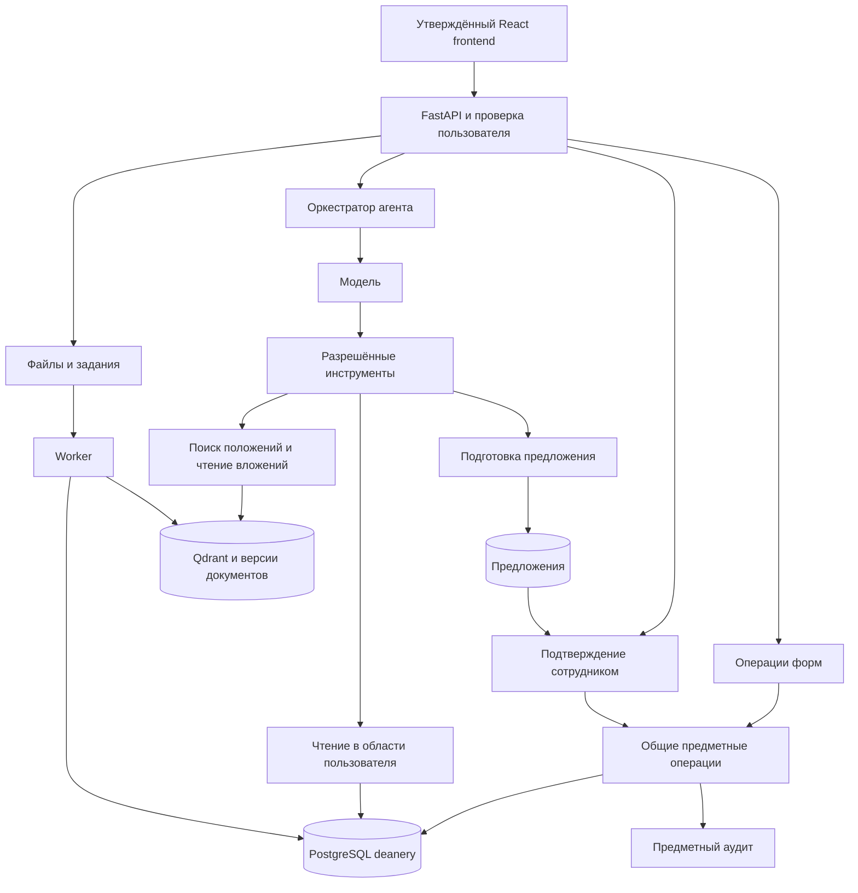

# Полная архитектура и план реализации backend агента деканата

**Актуальный подробный план для одобрения: [DETAILED_IMPLEMENTATION_PLAN.md](DETAILED_IMPLEMENTATION_PLAN.md).** Он включает выбранные пользователем очередь решений, передачу сотруднику, раздельное исполнение и результат работы с вложениями. Ниже сохранена общая архитектура базового объёма; при расхождении приоритет имеет новый план. Реализация до одобрения не начинается.

Backend строится под утверждённый React frontend. Основной инструмент пользователя — ИИ-агент в существующем чате; таблицы и формы дают прямой доступ к предусмотренным интерфейсом операциям. Агент и формы используют одни предметные правила, одну БД и один исполнитель изменений.

План охватывает полный действующий функционал корневого агента, все серверные обращения утверждённого frontend и всю приложенную структуру `deanery`. Это спецификация будущей реализации; работающий сервер, подключённая модель и мигрированная БД в текущем пакете ещё не созданы.

## 1. Основа и границы проекта

| Основа | Зафиксированная версия и назначение |
|---|---|
| Интерфейс | [Lyaako/dean-agent-front, react-frontend](https://github.com/Lyaako/dean-agent-front/tree/9c68ae0c5f062b87811058599151bc135576b33d/frontend), commit `9c68ae0c5f062b87811058599151bc135576b33d`. Его страницы, формы, дизайн и API определяют требования к backend |
| Агент | [Ethenkam/dean-agent, корневой dean_agent](https://github.com/Ethenkam/dean-agent/tree/d92bf5fbfc5b37c3236a6454aeffa5374fe88b11/dean_agent), commit `d92bf5fbfc5b37c3236a6454aeffa5374fe88b11`. Переносятся действующие инструменты, диалог, поток событий, нормативный поиск и обработка вложений |
| База | Приложенные SQL: 56 таблиц, 312 столбцов, 83 внешние связи и 27 представлений, вместе с функциями, процедурами, ограничениями и аудитом |
| Исключённая реализация | Старый проект и `backend_dean` не используются как основа |

Контракт берётся из реального `frontend/src`, а макет служит визуальным образцом. Восемь вкладок остаются: студенты, группы, расписание, курсовые и ВКР, справки, практики, сотрудники, OLAP. В текущем React OLAP — `ComingSoonPage`, но пользователь прямо включил его полную реализацию; актуальные требования и вопросы для подтверждения находятся в разделе 5.4 [подробного плана](DETAILED_IMPLEMENTATION_PLAN.md).

Необходимый результат — работающая система: вопрос вызывает настоящие инструменты, ответ опирается на БД или документы, предложение после подтверждения меняет БД, а таблица показывает этот результат. Ответы-заглушки не являются реализацией агента.

## 2. Архитектура и стек

Используется модульный монолит: один Python-проект, API и отдельный процесс worker из того же проекта. Это позволяет применять одинаковые правила в ручных формах, инструментах агента и фоновых заданиях.

| Компонент | Ответственность |
|---|---|
| FastAPI и Pydantic | HTTP-контракт `/api/v1`, проверка запросов, авторизация, ресурсы, workflows, SSE, предложения и файлы |
| DeepAgents и совместимый Chat Completions провайдер | Понимание запроса, выбор инструментов, уточнения и формирование русского ответа |
| SQLAlchemy 2 и psycopg | Транзакции, параметризованное чтение/запись, вызов функций и процедур PostgreSQL |
| Alembic | Воспроизводимые миграции исходной предметной схемы и необходимых служебных сущностей |
| PostgreSQL | Предметные данные `deanery`, служебные данные `agent_backend`, защищённые проекции `backend_api`, очередь заданий |
| Qdrant и BGE-M3 | Нормативный поиск по dense/sparse представлениям с объединением результатов RRF |
| Приватное файловое хранилище | Оригиналы и результаты обработки конкретных версий файлов; на первом развёртывании достаточно закрытого тома |
| Worker | Обработка файлов, импорт и переиндексация нормативных документов, применение наступивших приказов |
| Reverse proxy | Один origin frontend/API, HTTPS и передача SSE без буферизации |

Python — 3.12 или новее в пределах совместимости исходного агента. Точные версии библиотек фиксируются после проверки совместимости, включая DeepAgents и его профиль инструментов. Redis, отдельный брокер сообщений и микросервисы для каждой предметной области не требуются.



Модель предлагает вызов инструмента. Backend проверяет его аргументы и решает, допустима ли операция. Инструмент не получает право просто потому, что модель смогла сформировать SQL или назвать идентификатор.

## 3. Организация кода

```text
backend/
  app.py             # сборка приложения и маршрутов
  auth/              # login, refresh, logout, me, область пользователя
  resources/         # реестр, schema, чтение, фильтры и lookup
  operations/        # общие изменения записей и шесть workflows
  agent/             # DeepAgents, tools, история, ограничения и SSE
  proposals/         # preview, snapshot, срок действия и решение
  files/             # загрузка, версии, извлечение и скачивание
  knowledge/         # нормативные источники, версии, BGE-M3 и Qdrant
  jobs/              # очередь, worker, повторы и запланированные приказы
  db/                # соединения, модели, миграции и контекст аудита
  tests/             # контракт, PostgreSQL, агент и сценарии frontend
```

Контроллер разбирает запрос и передаёт проверенного пользователя предметной операции. Операция проверяет права, поля, связи и состояние, выполняет транзакцию и возвращает результат. Агент вызывает эти же операции в режиме подготовки предложения. Все предметные таблицы отражаются в метаданных; дополнительные HTTP-сервисы создаются только для необходимых действий.

## 4. Полная предметная база

Схема сохраняется целиком. Курс, семестр, шкала результатов, долги, календарь, нагрузка и сводки вычисляются существующими функциями и представлениями. Python не создаёт конкурирующую копию этих правил.

| Область | Таблицы |
|---|---|
| Справочники, 20 | `position`, `academic_degree`, `academic_title`, `education_level`, `study_form`, `funding_type`, `student_status`, `control_type`, `lesson_type`, `score_band`, `academic_term`, `holiday`, `pair_time`, `order_type`, `leave_reason`, `contact_relation`, `scholarship_type`, `document_type`, `request_status`, `app_role` |
| Люди и структура, 7 | `person`, `employee`, `institute`, `department`, `teacher`, `dean_office_staff`, `classroom` |
| Образовательные программы, 5 | `specialty`, `study_program`, `curriculum`, `discipline`, `curriculum_item` |
| Контингент и контакты, 4 | `study_group`, `student`, `contact_person`, `student_contact` |
| Учебный процесс, 6 | `teaching_assignment`, `schedule_slot`, `attendance`, `grade_sheet`, `grade`, `grade_correction` |
| Приказы и документы, 5 | `academic_order`, `order_student`, `scholarship`, `academic_leave`, `document_request` |
| Практики и работы, 4 | `organization`, `organization_contact`, `practice_placement`, `academic_work` |
| Пользователи, агент и аудит, 5 | `app_user`, `agent_intent`, `agent_request`, `audit_log`, `audit_log_detail` |

Все 27 представлений сохраняются: `v_students`, `v_curriculum`, `v_teachers`, `v_employees`, `v_groups`, `v_schedule`, `v_schedule_calendar`, `v_schedule_hours`, `v_grades`, `v_last_result`, `v_performance`, `v_debtors`, `v_expulsion_risk`, `v_student_summary`, `v_student_rating`, `v_active_scholarships`, `v_teacher_load`, `v_document_queue`, `v_attendance_stats`, `v_student_orders`, `v_academic_leaves`, `v_practice`, `v_academic_works`, `v_student_contacts`, `v_audit`, `v_pending_orders`, `v_grade_corrections`.

Наличие таблицы в БД не делает её публично редактируемой. Справочники используются для чтения и связей, официальные состояния меняются процедурами, аудит создаётся триггерами. Составные ключи сохраняются полностью, например `order_student(order_id, student_id)`, `student_contact(student_id, contact_person_id)`, `audit_log_detail(audit_id, column_name)`.

CHECK, UNIQUE, FK, триггеры, неизменяемость приказов и ограничения закрытых ведомостей остаются последним уровнем контроля. При реализации проверяются все SQL-тесты на настоящем PostgreSQL. Исходные скрипты с пересозданием схемы и демонстрационными настройками используются только в отдельной тестовой БД; production получает миграции без автоматического удаления данных.

Полный перечень полей, ключей и отношений: [DATABASE_CATALOG.md](DATABASE_CATALOG.md) и [resource-catalog.json](resource-catalog.json).

## 5. Служебные данные backend

В отдельной схеме `agent_backend` нужны следующие сущности. Они поддерживают агент и текущий интерфейс, не заменяя предметный аудит.

| Сущность | Что хранит |
|---|---|
| `auth_session` | Пользователь, семейство refresh, хэши токенов, срок, ротация и отзыв |
| `chat_session` | Владелец и состояние серверной беседы |
| `chat_message` | Сообщения, порядок и ссылки на допустимые вложения |
| `agent_run` | Запуск, session/user, состояние, tools, ошибки, длительность и связь с `deanery.agent_request` |
| `proposal` | Автор, неизменяемая команда, preview, зависимости, snapshot, срок, решение и применённый результат |
| `idempotency_record` | Пользователь, маршрут, ключ, хэш запроса и окончательный ответ |
| `file`, `file_version` | Владелец, имя, размер, MIME, хэш, приватное расположение, готовность и извлечённый контекст |
| `job` | Вид задания, состояние, попытки, lease, прогресс, результат и безопасная ошибка |
| `regulation`, `regulation_version`, `regulation_chunk` | Источник, опубликованная версия, страницы/пункты, фрагменты и идентификаторы индексирования |

Создаются индексы для реально используемых путей: владелец/сессия, порядок сообщений, pending предложения, токены, незавершённые jobs и текущие версии документов. Уникальность идемпотентных ключей, результатов заданий и конкретных версий обеспечивается БД. Обязательные связи между запуском, сообщением, вложением и предложением сохраняются сервером; клиентский UUID не служит доказательством доступа.

## 6. Авторизация и область доступа

Сохраняются пять ролей: `admin`, `director`, `dean_staff`, `teacher`, `student`. В исходном `app_user` одна роль; API возвращает массив из одного элемента, как ожидает frontend.

Базовая политика: admin выполняет разрешённые административные операции; director и dean_staff работают в своей организационной области; teacher видит относящиеся к своим назначениям группы, занятия и результаты; student читает свои данные и может создавать собственную допустимую заявку на документ. Точные разрешения закрепляются матрицей ресурс/операция/поле/область и контрактными тестами. Предложения применяют действующие роли сотрудников, которые допускает текущий клиент, с повторной серверной проверкой области.

Область определяется по реальным связям person, employee, teacher, dean_office_staff, department, institute и учебного плана группы. Если связь не позволяет однозначно установить область, сервер отказывает. Клиент не может прислать новый institute_id, чтобы расширить свои права.

Login проверяет пароль и активность пользователя. Access token хранится в памяти каждой вкладки, refresh — в общей HttpOnly cookie. CSRF-токен хранится в localStorage текущего frontend и остаётся действительным после refresh. Refresh ротируется; повтор старого токена отзывает семейство. Проверяются истечение, logout, лимит попыток входа и параллельные вкладки.

Текущий frontend использует Web Locks для последовательного refresh. В браузерах без него возможна гонка ротации; этот случай входит в проверку целевых браузеров. Обычные CRUD-запросы отправляют Bearer, но не `X-CSRF-Token`: нельзя требовать этот заголовок от них без правки клиента. Cookie-refresh защищается CSRF и Origin; остальные действия — проверенной сессией и допустимым Origin.

Права проверяются одинаково для таблиц, карточек, lookup, SQL-инструмента, предложения, истории, файлов и скачивания. Хэши паролей и закрытые персональные поля не попадают в metadata, результат инструмента или SSE автоматически.

Агент читает через разрешённые проекции `backend_api` с реальным ограничением строк и полей. Одна глобальная роль чтения `deanery_read` не обеспечивает изоляцию институтов. Проекции и сервисные функции проверяются на PostgreSQL, включая возможный обход RLS представлением владельца. Рабочие роли не являются владельцами, superuser или BYPASSRLS; роль миграций отделена.

## 7. Поддержка всех действующих страниц

| Страница | Чтение | Серверные изменения и правила |
|---|---|---|
| Студенты | `v_student_summary`, `student` и связанные lookup | В форме PATCH только `funding_type_id`, `needs_dormitory`, `is_foreign`; зачисление, группа и статус — через шесть workflows |
| Группы | `v_groups`, `study_group`, учебные планы и преподаватели | Создать/изменить name, curriculum_id, curator_id, headman_id, is_archived. Староста принадлежит составу; удаление допустимо только при отсутствии запрещающих зависимостей |
| Расписание | `academic_term`, `v_schedule_calendar`, `holiday`, `pair_time`, lookup поручений и аудиторий | CRUD `schedule_slot`: assignment_id, classroom_id, weekday, pair_number, week_parity, term_id, valid_from, valid_to. Пересечения, период и связи проверяются; правка слота относится ко всем его датам |
| Курсовые и ВКР | `v_academic_works`, `academic_work` | student_id при создании, item_id, topic, supervisor_id, reviewer_id, order_id. Только coursework/final_attestation соответствующего учебного плана; student_id после создания неизменяем |
| Справки | `v_document_queue`, `document_request`, типы, статусы и исполнители | Создать заявку, изменить допустимые copies/purpose/status/исполнителя и выполнить допустимое удаление. student_id неизменяем, completed_at определяет сервер/БД, финальное состояние соблюдает правила схемы |
| Практики | `v_practice`, `practice_placement`, организации и контакты | student_id при создании, item_id, supervisor_id, org_contact_id, start_date, end_date, order_id. Только позиции kind=practice, корректные даты/приказ/руководители; student_id неизменяем |
| Сотрудники | `v_employees`, `employee`, связанная `person` | При создании выбирается существующая person. Изменяются кадровый номер, должность, ставка, даты и ФИО связанной person. employee.person_id после создания неизменяем |
| OLAP | Сейчас заглушка React; целевой результат — полная вкладка | Восемь режимов макета, реальные данные; точный новый контракт прямо согласуется |

Фронтенд уже реализует поиск, локальную сортировку, фильтры, пагинацию, закрытие формы, предупреждение о несохранённом и копирование сообщений. Эти функции не получают вымышленные серверные endpoints. Backend возвращает необходимые данные и метаданные в существующих форматах.

У сотрудника новая форма сначала сохраняет ФИО запросом PATCH person, затем реквизиты запросом PATCH employee. Каждый запрос атомарен отдельно. Если второй не прошёл, первое изменение могло сохраниться; общую транзакцию через два текущих запроса обещать нельзя.

`/schema` описывает реальные PostgreSQL-типы, nullable/default, русские descriptions, ключи, связи, читаемые/записываемые поля и операции по ролям. `RecordDialog.config.order` задаёт только порядок: список доступных полей обязан ограничивать сервер. Проверяется полное замыкание FK-lookup для форм и окна предложения.

## 8. Шесть предметных workflows

| Команда | Исполнение | Результат |
|---|---|---|
| `enroll_student` | `fn_enroll_student` | Person, student, приказ и состав приказа одной транзакцией |
| `transfer_student` | `sp_transfer_student` | Перевод в допустимую группу через приказ |
| `grant_academic_leave` | `sp_grant_academic_leave` | Отпуск с причиной, периодом и приказом |
| `return_from_leave` | `sp_return_from_leave` | Возврат в прежнюю либо указанную допустимую группу |
| `expel_student` | `sp_expel_student` | Отчисление по явно указанному основанию через приказ |
| `reinstate_student` | `sp_reinstate_student` | Восстановление отчисленного студента через приказ |

Сохраняются имена полей frontend. `signed_by` — числовой идентификатор; `group_name`, `funding` и причина отпуска приходят названиями и преобразуются серверным адаптером. Номер приказа, подписант и обязательное основание проверяются. Подписант должен иметь право на соответствующий институт.

В зачислении frontend не передаёт order_date: сервер задаёт дату оформления по Europe/Moscow. Пустая effective_date означает сегодня, как написано в форме. В предложении агента разрешённые по умолчанию даты отображаются и фиксируются; переход календарной даты не должен молча менять подтверждаемый смысл.

Операция возвращает `student_id`, `order_id`, `effective_date` и status `applied` либо `pending`. Для будущей даты сохраняется подтверждённый приказ, а worker применяет его в срок через механизмы исходной БД, включая `fn_apply_due_orders`. Future-зачисление может заранее создать запись student со статусом «Зачислен», как предусмотрено исходной функцией.

Повтор одного Idempotency-Key не создаёт второй приказ. Worker не принимает нового решения об отчислении: он исполняет уже оформленный приказ, соблюдает ограничения БД и сохраняет связь с исходным действием и системным выполнением. Функции отмены приказов и коррекций оценок остаются в схеме; новые интерфейсные процессы для них не добавляются.

## 9. Полный агент

### Диалог и исполнение

Сохраняются русский SYSTEM_PROMPT, DeepAgents, совместимый Chat Completions API, температура 0, история последних 20 сообщений, trace callbacks и перечень tools_used/proposals. Запуск получает пользователя из авторизации, а не из `X-Actor-ID`. Сессия принадлежит пользователю, параллельные запуски одной сессии отклоняются, состояние и сообщения сохраняются в БД.

Модель уточняет неоднозначного студента, группу, дисциплину, реквизиты или основание. Она не выбирает первого однофамильца и не выдумывает подписанта. Лимиты времени, размера результатов и числа шагов задаются сервером; исходный предел рекурсии 30 служит начальной настройкой, затем проверяется сценариями.

Факты берутся из инструментов. Дата внесения оценки не считается доказанной датой возникновения долга. Нехватка записей не доказывает оставшиеся попытки пересдачи или отсутствие приказа. Пропуски не вычисляются из отсутствия attendance. Риск отчисления из представления объясняется как сигнал для проверки, а не решение агента.

### Инструменты

| Инструмент | Назначение и границы |
|---|---|
| `query_deanery` | Реальное чтение студентов, результатов, долгов, расписания, посещаемости, приказов, отпусков, стипендий, практик, работ, нагрузки и допустимого аудита |
| `propose_sql_change` | Исходные простые INSERT/UPDATE одной строки в десяти разрешённых рабочих таблицах; формирует предложение |
| `search_regulations` | Исходный гибридный поиск опубликованных нормативных документов с названием, источником, версией и страницей/пунктом |
| `prepare_workflow` | Дополнение для шести уже существующих приказных операций frontend; общий workflow в режиме preview |
| `prepare_record_change` | Типизированные изменения существующих форм, не выражаемые исходным SQL-whitelist; те же разрешённые поля, проверки и preview |
| `read_attachment_text` | Контролируемое чтение следующих фрагментов доступной обработанной версии вложения |

Исходный SQL-whitelist: `document_request`, `academic_work`, `grade`, `attendance`, `grade_sheet`, `practice_placement`, `teaching_assignment`, `schedule_slot`, `organization_contact`, `contact_person`. Наборы разрешённых insert/update полей сохраняются узкими и дополнительно проверяются общими предметными правилами; вычисляемые и служебные значения определяет сервер.

Типизированная команда нужна для person (ФИО), employee, study_group, трёх разрешённых полей student и допустимых правок форм за пределами SQL-whitelist полей: например item_id работы/практики, assignment_id/term_id слота. Она не открывает свободный SQL для этих ресурсов. Поля, которым запрещена смена после создания, остаются неизменяемыми во всех инструментах.

### Ограничение SQL

Чтение проверяется AST через pglast: одна SELECT-команда, явно перечисленные поля, LIMIT 1..60, исходный предел SQL 6000 символов, READ ONLY и таймаут 5 секунд. Запрещаются DML внутри CTE, несколько statements, SELECT *, блокировки, неразрешённые объекты/функции и попытки сменить контекст. Вместо свободного information_schema агент получает только безопасное описание разрешённой структуры.

SQL изменения допускает одну INSERT VALUES-строку или UPDATE по точному PK, простые литералы и whitelist полей. Исходный предел текста — 4000 символов. AST преобразуется в проверенную команду общего исполнителя; сервер не исполняет произвольный текст из ответа модели. DELETE, DDL, массовые изменения и самостоятельное подтверждение недоступны агенту.

Профиль DeepAgents сохраняет запрет файловых инструментов, execute и автоматических subagent. Legacy-инструменты по старым предметным моделям `public` не включаются; поиск/карточки/статистика выполняются через актуальную deanery.

### Предметные возможности

Агент ищет студента и объясняет карточку; считает подтверждённые долги и результаты; сопоставляет группу и учебный план; показывает расписание и нагрузку; анализирует записанную посещаемость; читает приказы, отпуска и стипендии; создаёт/корректирует разрешённые заявки, работы, практики, назначения, слоты, ведомости и оценки; подготавливает шесть workflows; отвечает по положениям и приложенным документам.

Закрытая оценка не меняется прямым UPDATE. Стипендии читаются, но новый workflow назначения в текущем frontend и действующих tools отсутствует. Агент объясняет эти границы и не обходит процедуры. Удаление через разрешённую ручную форму поддерживается backend; исходный агент и текущий INSERT/UPDATE preview не получают новый DELETE-инструмент.

## 10. Предложения и подтверждение

Пример: «Переведи Иванова в ИДБ-24-12 по приказу …». Агент находит нужного студента, уточняет реквизиты, вызывает prepare_workflow и показывает ожидаемое состояние вместе с приказом и связанными эффектами. До решения сотрудника предметное изменение не фиксируется. После «Применить изменения» backend применяет сохранённую команду, и frontend обновляет существующие запросы таблиц.

Для обычной формы подтверждением является её кнопка сохранения. Повторное окно proposal поверх ручного CRUD не вводится: frontend ожидает в ответе сохранённую Row. Предложение агента использует текущее окно «было → стало» и обязательный комментарий решения длиной 10..2000 символов.

Подготовка проходит через общий исполнитель в откатываемой транзакции. Сохраняются точные параметры, before/after, связанные эффекты и значимые зависимости: статус студента, учебный план, ведомость, период, преподаватель, приказ или другие строки, влияющие на допустимость. Payload после подготовки неизменяем. Актуальный предлагаемый срок действия — 24 часа для очереди/передачи по подробному плану; он закрепляется конфигурацией и тестами.

При подтверждении сервер блокирует proposal и предметные строки в стабильном порядке, повторно проверяет пользователя, область, срок, зависимости и состояние, затем выполняет изменение. Изменение, предметный аудит, решение и идемпотентный результат фиксируются одной транзакцией. Ошибка откатывает всё действие, предложение не выдаётся за применённое.

Публичные статусы — только `pending`, `approved`, `rejected`. `approved` публикуется после успешной записи; будущий подтверждённый приказ при этом ещё имеет собственный status `pending`. При stale/expired сервер возвращает предусмотренный error и требует нового предложения. Повтор решения не меняет данные второй раз; конфликт ключа с другим телом отклоняется.

Workflow представляется текущим INSERT/UPDATE preview основной записи; приказ и дополнительные изменения перечисляются в related_effects/note. Нового renderer не требуется. Dry-run INSERT может расходовать sequence; временный ID не обещается как окончательный. Внезапные внешние действия из preview не выполняются.

## 11. Вложения и нормативный поиск

### Вложения текущего чата

Цепочка: upload → приватная file/version → job → проверка и извлечение → готовность → передача ссылок текущего сообщения агенту → ответ с указанием файла/страницы. Download возвращает оригинал только доступной версии. Выбор произвольного пути/URL или чужого version_id не даёт доступа.

Неизменный React принимает PDF, DOCX и TXT: максимум 10 000 000 байт на файл, пять файлов, 20 000 000 байт суммарно. Backend повторяет проверки размеров, содержимого, MIME, владельца и готовности. Корневой парсер дополнительно умеет CSV и PNG/JPEG/WebP; эта способность сохраняется внутри агента, но выбор таких файлов текущим frontend не обещается.

Исходные предлагаемые бюджеты: до 60 000 символов начального контекста, визуальное представление модели до десяти страниц, отклонение защищённых PDF и PDF свыше 500 страниц, бюджеты ZIP/XML и изображений. По прямому дополнению пользователя OCR всех сканированных страниц принятого PDF теперь входит в объём и не ограничивается десятью визуальными страницами; средство/лимиты согласуются по 5.7 актуального плана. Последующие текстовые/OCR-фрагменты предоставляет read_attachment_text с привязкой к версии/странице. Покрытие OCR, ошибки страниц, передача модели и использование в ответе показываются отдельно.

Новая ветка frontend позволяет отправлять только вложения и ждать завершения обработки. Backend принимает реальные refs, а не делает вывод из списка имён в message. Черновики разделены по чатам; соседний файл не включается в запрос автоматически. Права на сохранённые вложения перепроверяются при дальнейшем использовании.

### Нормативные документы

Сохраняется управляемый импорт, получение версии и reindex из исходного агента. Оператору достаточно защищённой технической команды/служебного API: новый кабинет знаний не нужен.

Импорт сохраняет оригинал, название, исходную ссылку и версию; извлекает текст со страницами/пунктами; проверяет качество; создаёт фрагменты; получает dense/sparse embeddings BGE-M3; индексирует их в Qdrant. Версия становится опубликованной только после успешной обработки. Запрос выполняет hybrid поиск и RRF, затем сервер проверяет актуальность и доступность найденной версии.

Ответ содержит проверяемый источник. Если документ не найден или индекс недоступен, агент говорит об этом. Вложенное заявление не становится положением автоматически. Инструкции, написанные внутри PDF/DOCX или найденного документа, рассматриваются как текст источника и не расширяют инструменты/права.

## 12. Точный внешний API

Все маршруты имеют префикс `/api/v1`; тела и ответы совпадают с текущими api-модулями React.

| Маршрут | Назначение |
|---|---|
| POST `/auth/login`, POST `/auth/refresh`, GET `/auth/me`, POST `/auth/logout` | Вход, ротация сессии, проверенный профиль и выход |
| GET `/schema` | Метаданные и разрешения для вкладок, форм, lookup и proposal |
| GET `/resources/{name}` | Предметные представления, карточки и связанные справочники |
| POST/PATCH/DELETE `/resources/{table}` | Разрешённые действия формы, окончательная сохранённая Row либо 204 |
| PATCH `/resources/person?person_id={id}` | Только допустимая правка ФИО сотрудника |
| POST `/workflows/{name}` | Шесть приказных операций с Idempotency-Key |
| GET `/agent/capabilities` | Реальная поддержка вложений и доступность агента |
| POST `/agent/chat/stream` | Запуск полноценного агента и SSE |
| GET `/agent/proposals/{id}` | Preview и состояние предложения |
| POST `/agent/proposals/{id}/decision` | Решение сотрудника с Idempotency-Key |
| POST `/files` | Multipart upload с Idempotency-Key, file/version и job |
| GET `/jobs/{id}` | Обработка: queued/running/succeeded/failed, прогресс 0..100 |
| GET `/files/{file_id}/versions/{version_id}/download` | Закрытое скачивание конкретного оригинала |

GET ресурсов принимает limit 1..500, offset, разрешённые фильтры и sort. Поля проверяются по типу, имена объектов — по реестру. PATCH/DELETE требуют полный PK. Для календаря обязательны lesson_date__gte/lte и сортировка lesson_date,pair_number,group_name. Для формы справки нужен поиск employee по person_id. Неизвестное поле не вставляется в SQL.

Даты — YYYY-MM-DD, временные метки — ISO 8601 с зоной, numeric передаётся без потери точности. Null отличается от отсутствующего PATCH-поля. `/schema` использует format_type PostgreSQL, включая default/comments, а не условные типы из статического каталога.

SSE использует ровно существующие события: status, session, tool_call, tool_result, done, error. Финальный done содержит run_id, session_id, Markdown answer, proposals и tools_used. Инструменты показывают безопасные ограниченные сводки. Heartbeat и корректные границы событий поддерживают длительный запрос; новые обязательные events/blocks не вводятся.

Сервер сообщает ошибки в существующем формате `{error:{code,message,details},request_id}` и возвращает X-Request-ID. До открытия SSE используется HTTP error, после — event error. Коды и сообщения соответствуют api/errors.ts; DSN, секреты, трассировки и чужие данные наружу не выдаются. Полные тела и типы приведены в [API.md](API.md).

## 13. Worker, аудит и устойчивость

Очередь хранится в PostgreSQL. Worker забирает готовые задания с блокировкой SKIP LOCKED, фиксирует lease, ограничивает попытки и сохраняет результат. Истёкшая аренда после сбоя позволяет безопасный повтор. Уникальность результата и транзакции исключают двойную публикацию версии или повтор применения одного приказа.

Контекст аудита app.user_id и app.agent_request_id выставляет сервер локально в транзакции. Ручная форма не выдаёт себя за запрос агента. Сохраняются deanery.agent_request, audit_log и audit_log_detail: кто выполнил действие, по какому запросу и какие значения поменялись. Модель не задаёт авторство и не меняет журнал.

Если модель недоступна, ручные формы продолжают работать. Если поиск недоступен, нормативный ответ не выдумывается. Если БД недоступна, пустой результат и успешная запись не имитируются. Ошибки worker видны в job, а не скрыты за progress=100.

По прямому подтверждению пользователя кнопка «Остановить» посылает отдельную серверную команду: backend прекращает новые tools и кооперативно отменяет генерацию. Обычный разрыв SSE/перезагрузка этого не делают; run продолжается, переподключение получает пропущенные события/итог без повторного запроса. Точные контракты и хранение согласуются по 5.6 актуального плана. Подтверждённая отдельным decision транзакция не отзывается.

По прямому уточнению пользователя ChatStore становится серверным: список/названия и полная сохранённая история доступны с другого устройства. Переименование/удаление обращаются к серверу; перенос старых локальных данных, черновики и удаление/архивирование ещё согласуются по разделу 5.5 актуального плана. Предложения и предметный аудит не стираются очисткой чата.

## 14. Последовательность реализации

| Этап | Работы | Проверяемый результат |
|---|---|---|
| 1. База и контракт | Зафиксировать версии, перенести deanery в миграции, поднять тестовую БД, прогнать исходные SQL-тесты, проверить поля/ключи/связи/псевдонимы frontend | Воспроизводимая БД, 56 таблиц/312 столбцов/83 FK/27 views, полный перечень текущих routes и lookup |
| 2. Сессия и чтение | Auth, область пользователя, безопасные проекции, schema, GET resources, фильтры и сортировка | Неизменный frontend входит и загружает все действующие страницы; тесты пяти ролей подтверждают изоляцию |
| 3. Формы и workflows | Общий исполнитель, точные write_fields, CRUD форм, linked person, шесть workflows, идемпотентность и применение будущих приказов | Кнопки сохраняют действительные данные, ошибки правил видны в форме, повтор workflow не создаёт второй приказ |
| 4. Предложения | Dry-run, before/after, зависимости, TTL, immutable payload, decision и атомарность аудита | Подготовка не меняет предметные данные; подтверждение применяет ровно допустимое действие, stale/повтор/сбой проверены |
| 5. Агент | Перенос DeepAgents, три исходных tools, типизированные команды форм/workflows, история, SSE, ограничения и уточнения | Диалог обращается к реальной БД, создаёт проверяемые предложения и использует текущий React чат |
| 6. Файлы и нормативы | Upload/job/download, parser, read_attachment_text, импорт версий, BGE-M3, Qdrant и ссылки | Полный цикл файл → готовность → вопрос → подтверждённая цитата; реальный нормативный поиск |
| 7. Приёмка React | E2E именно зафиксированного frontend, роли, формы/агент попарно, два окна, файлы, отказы и конкуренция | Все текущие серверные обращения клиента работают без его переделки, итог БД и аудит проверены |
| 8. Развёртывание | Compose, HTTPS/SSE, секреты, readiness, backup/restore, инструкция запуска и импорта | Система воспроизводимо запускается, восстанавливается и корректно продолжает задания после перезапуска |

Этапы 4 и 5 не принимаются по красивому ответу в чате: проверяется вызванный tool, сохранённая команда и итог предметной БД. Этап 6 нужен для полноты исходного агента и действующего интерфейса, его нельзя заменить сообщением «файл прикреплён».

## 15. Обязательная приёмка

1. Контракт: маршруты, union-статусы, nullable, реальные types/default/comments, псевдонимы страниц, FK-lookup и безопасные ошибки.
2. PostgreSQL: исходные SQL-проверки, триггеры, CHECK/UNIQUE, процедуры, транзакции, составные ключи и реальная изоляция строк.
3. Права: чужой институт/студент/назначение, подмена PK/FK, собственная person, файлы/сессии/предложения и закрытые поля во всех каналах.
4. Формы: создание/правка/допустимое удаление, immutable parent, linked ФИО сотрудника, ошибка второго PATCH, статусы и даты.
5. Workflows: шесть действий, сегодняшние и будущие даты, несовместимые статусы, реквизиты, повтор, подписант и применение после рестарта.
6. SQL tools: запрет DML-CTE, SELECT *, нескольких statements, set_config, произвольных функций/схем, массовой записи и закрытых оценок.
7. Proposal: rollback подготовки, зависимые строки, expiry/stale, конкурирующие подтверждения, неверная роль, отказ, повтор и атомарный аудит.
8. Агент: неоднозначное ФИО, уточнение основания, реальные tools, история, отсутствие выдуманных дат/попыток, нормативные источники и отключение провайдера.
9. Файлы/RAG: чужая или неготовая версия, тип/размер, испорченный PDF/DOCX, ZIP/XML bomb, неполный скан, отзыв версии, сбой индекса и инструкции внутри документа.
10. SSE: произвольное деление UTF-8/JSON, ошибка до/после открытия, разрыв, session_busy, безопасный trace и единственный конечный результат.
11. Сквозные пары: создать справку, работу/практику, слот, изменить ФИО и перевести студента через форму и через агента; сравнить предметные значения и правила, различая источник аудита.
12. Восстановление: backup/restore БД и оригиналов, восстановимая переиндексация, повтор jobs без двойного результата.

Тесты ответов модели проверяют данные и действия, а не только совпадение формулировки. Существенные предметные тесты выполняются на настоящем PostgreSQL. Заглушки допустимы для воспроизведения сбоя провайдера/сети, но не заменяют сквозную приёмку.

## 16. Развёртывание и эксплуатация

Первый комплект Compose: frontend/reverse proxy, API, worker, PostgreSQL, Qdrant, BGE-M3 и приватный файловый том. Модель подключается по конфигурации совместимого провайдера. PostgreSQL и хранилище не публикуются в браузер; клиент работает через API.

Перед запуском нужны доступ к модели, совместимая среда BGE-M3, production-учётные записи/секреты, нормативные источники для индекса, реальные организационные привязки пользователей и правила хранения истории/файлов. Инструкция содержит запуск миграций отдельной ролью, проверку readiness, импорт положений, разбор failed jobs и восстановление.

Логи содержат request_id/run_id/job_id, стадии, длительность и безопасные коды ошибок. Содержимое документов, токены и закрытые поля не пишутся в обычный технический лог. Backup сохраняет PostgreSQL и оригиналы файлов; Qdrant должен восстанавливаться переиндексацией из сохранённых версий.

## 17. Ограничения текущего клиента

| Ограничение | Следствие для реализации |
|---|---|
| fetchAll: 40 страниц по 500, максимум 20 000 строк | Большая выборка может быть обрезана клиентом. Backend предварительно проверяет доступный объём и выдаёт понятную ошибку при превышении, а не частичную «полную» таблицу; для больших институтов понадобится согласованное изменение загрузки клиента |
| PATCH не передаёт версию строки | Транзакции сохраняют целостность, но не обнаруживают все перезаписи устаревшей формой. Snapshot защищает agent proposal; аналогичную гарантию ручной форме без изменения контракта обещать нельзя |
| Обычный POST resources без Idempotency-Key | Нельзя обещать exactly-once после неоднозначного сетевого сбоя. Для workflows/files/decision ключ уже предусмотрен и обязателен |
| Восстановление SSE | Прямо включено: тот же серверный run после обрыва/перезагрузки, без повторной генерации и дубликатов; точный контракт ещё согласуется |
| Два PATCH сотрудника | Возможно частичное сохранение формы: ФИО уже записано, реквизиты отклонены |
| Refresh fallback без Web Locks | Параллельная ротация может завершить сессию при строгой защите от повторного токена |
| Форматы выбора PDF/DOCX/TXT | Внутренний парсер фото/CSV сохраняется, но доступность их выбора в неизменном React не заявляется |
| Серверные чаты | Синхронизация прямо включена; перенос старого localStorage, черновики и правила удаления ещё согласуются; предметный аудит защищён |
| Proposal preview только INSERT/UPDATE | Агент сохраняет границу исходного инструмента без DELETE; допустимое ручное удаление поддерживает обычный endpoint |

## 18. Критерий завершения проекта

Проект завершён, когда зафиксированный React работает с реальным backend; реализованы семь действующих предметных страниц, шесть workflows, весь действующий корневой агент, предложения, вложения и нормативный поиск; исходная deanery сохранена; проверки ролей, транзакций, аудита и восстановления проходят; модель не может изменить данные вне разрешённых операций и без предусмотренного решения сотрудника.

Таблицы показывают те же предметные результаты, которые создаёт подтверждённая операция агента. Формы сохраняют работоспособность при недоступной модели. Новые продуктовые экраны и функции, отсутствующие в утверждённом frontend и действующем агенте, не входят в этот план.

Дополнительные детали: [API.md](API.md), [IMPLEMENTATION_PLAN.md](IMPLEMENTATION_PLAN.md), [ARCHITECTURE.md](ARCHITECTURE.md), [FUNCTIONAL_SPEC.md](FUNCTIONAL_SPEC.md), [FRONTEND_VERSION.md](FRONTEND_VERSION.md).
